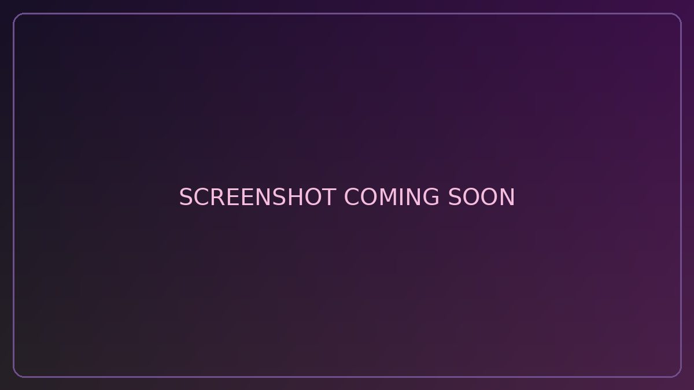
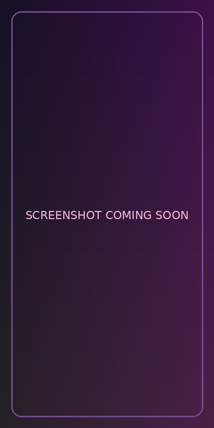

<div align="center">

# 🎴 Party Punishment

### 真心话 or 大冒险

**翻开一张卡片，让聚会更有趣。**

无需注册 · 无需输入数字 · 打开就能玩

[](https://littbox.github.io/party_punishment/)


[✨ 功能亮点](#-功能亮点) · [📸 界面预览](#-界面预览) · [🚀 快速开始](#-快速开始) · [🛠️ 自定义题库](#️-自定义题库)

</div>

---

## ✨ 功能亮点

| 🎀 真心话 | ⚡ 大冒险 |
| :--- | :--- |
| 100 道有趣的问题，聊出新故事 | 100 个轻松的小挑战，点燃气氛 |

- **一键开玩**：选择类型，立即翻牌；没有多余输入步骤。
- **沉浸式翻牌**：3D 翻转动画，仪式感拉满。
- **响应式布局**：桌面双列卡片，手机上下排列。
- **不重复抽取**：同类型题库一轮抽完才重新洗牌。
- **轻量静态网站**：原生 HTML / CSS / JavaScript，无需依赖、构建和后端。
- **尊重边界**：游戏以轻松有趣为主，任何挑战都可以跳过。

## 📸 界面预览

> **截图占位**：将项目截图保存至 `assets/preview-desktop.png` 和 `assets/preview-mobile.png`，GitHub 上就会自动显示。尚未上传截图时，下面的预览图会暂时为空。

<div align="center">
  
  <p><sub>桌面端 · 双卡片选择页面</sub></p>
  
  <p><sub>移动端 · 单列自适应布局</sub></p>
</div>

## 🎮 如何游玩

1. 打开 [在线游戏](https://littbox.github.io/party_punishment/)。
2. 选择 **真心话** 或 **大冒险** 卡片。
3. 等待卡片翻开，完成题目（不愿回答或挑战时可以跳过）。
4. 点击 **再抽一张** 继续，或者 **重新选择** 切换类型。

## 🚀 快速开始

```bash
git clone https://github.com/LittBox/party_punishment.git
cd party_punishment
```

直接用浏览器打开 `index.html`，或者使用 VS Code Live Server 本地预览。无需安装依赖。

### 项目结构

```text
party_punishment/
├── index.html       # 页面骨架
├── style.css        # 主题设计、响应式和翻牌动画
├── app.js           # 原项目的 200 道题库（保留）
├── game.js          # 抽题、洗牌、交互和动画状态
├── assets/
│   ├── preview-desktop.png   # 你稍后添加的截图
│   └── preview-mobile.png    # 你稍后添加的截图
└── README.md        # 项目说明
```

## 🛠️ 自定义题库

题库仍然维护在 `app.js` 的 `punishments` 对象中，格式如下：

```js
const punishments = {
  1: '【真心话】最近一次熬夜是为了做什么？',
  2: '【大冒险】模仿企鹅走路走 5 小步就行。',
};
```

新增时保持编号唯一，并保留 `【真心话】` 或 `【大冒险】` 前缀，`game.js` 会自动按类型分类。不要直接删除 `app.js`，它仍是题目来源。

## 🌐 部署

项目是纯静态网页。推送到 GitHub 后，在仓库 **Settings → Pages** 中选择 `Deploy from a branch`、`main`、`/(root)`，即可使用 GitHub Pages 托管。

## 💗 小提示

享受游戏，也尊重每个人的选择。题目仅供娱乐，所有人都可以选择跳过。

---

<div align="center"><sub>Made for good vibes ✦ Have fun, be kind.</sub></div>
